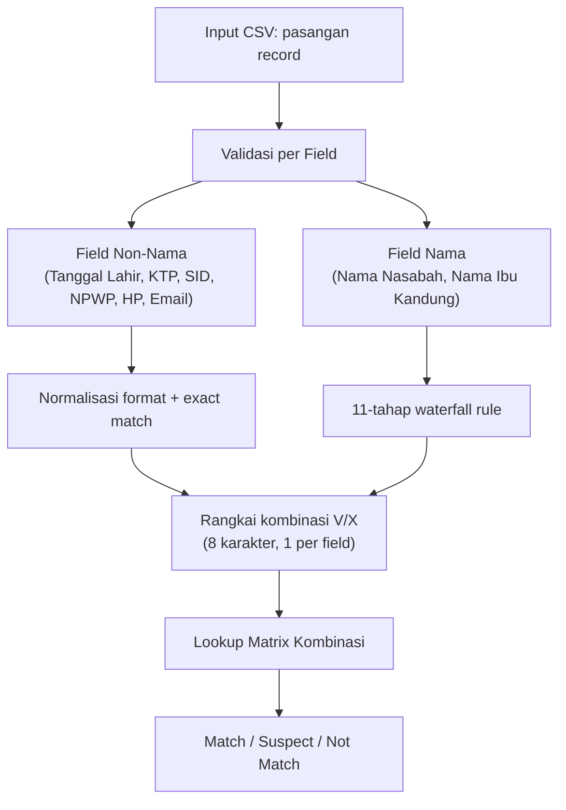

# Hampton Dedup — Metodologi Validasi Data Nasabah

## Ringkasan

Sistem membandingkan **pasangan record nasabah** (left vs right) untuk menentukan apakah keduanya merujuk ke orang yang sama (**Match**), meragukan (**Suspect**), atau berbeda (**Not Match**).

Pendekatan: **rule-based deterministic** dengan opsi pengecekan **LLM** hanya pada kasus abu-abu di field nama.

---

## Arsitektur Validasi



---

## 1. Validasi Field Non-Nama (Deterministik, Exact Match)

Setiap field dinormalisasi dulu, lalu dibandingkan **exact**. Salah satu kosong atau format tidak valid → langsung **X**.

| Field | Normalisasi | Contoh |
|---|---|---|
| **Tanggal Lahir** | Parse multi-format (dd/mm/yyyy, yyyy-mm-dd, yyyymmdd, dd-BULAN-yyyy, dll) → `yyyy-mm-dd`. Format rusak → X. Nilai dummy `1900-01-01` → X walau sama. | `01/05/1990` = `1990-05-01` → V |
| **KTP** | Ambil digit saja | `3201234567890001` vs `3201234567890001` → V |
| **NPWP** | Ambil digit saja (15 dan 16 digit **tidak** disamakan) | `01.234.567.8-901.000` → `012345678901000` |
| **HP** | Ambil digit, samakan awalan: `+62` / `62` / `0` → `0` | `+62812345` = `0812345` → V |
| **Email** | Lowercase, hapus spasi. Nilai dummy (`noemail@gmail.com`, dll) → X walau sama. | |
| **SID** | Uppercase, hapus spasi | |

> [!NOTE]
> Nilai yang dianggap **kosong**: `NULL`, `N/A`, `NA`, `-`, `--`, `.`, `0`, `TIDAK ADA`, `UNKNOWN`, dll.
>
> Nilai **dummy**: angka yang hanya 1 digit berulang (`000000`, `999999`), email placeholder (`noemail@...`), tanggal `1900-01-01` → selalu **X**, walau sama di kedua sisi.

---

## 2. Validasi Field Nama (Rule-Based Waterfall)

Berlaku untuk **Nama Nasabah** (`cfna1`) dan **Nama Ibu Kandung** (`cfmotn`). Aturan dievaluasi berurutan; **aturan pertama yang cocok langsung dipakai** (early exit).

### Tahap 0 — Preprocessing

Sebelum masuk waterfall, kedua nama melewati pipeline normalisasi:

1. **Bersihkan**: uppercase, hapus aksen/diakritik, hapus tanda baca & angka, rapikan spasi.
2. **Lepas gelar/sapaan depan**: H., Hj., DR., IR., PROF, IBU, NY., TN., ALM, dll — hanya jika sisa nama ≥ 2 kata.
3. **Lepas gelar belakang**: SE, SH, S.Kom, MM, M.Si, Ph.D, Sp.OG, dll.
4. **Deteksi akhiran generasi**: JR, SR, II, III, IV — disimpan terpisah untuk pengecekan tahap 3.
5. **Standarisasi ejaan lama**: OE→U, DJ→J, TJ→C, SJ→SY, NJ→NY (hanya jika ada penanda jelas; NJ di tengah kata seperti SIMANJUNTAK tidak diubah). J tunggal menjadi Y jika ada penanda ejaan lama (DJOJO → JOYO).
6. **Standarisasi varian kata**: Muhammad/Mohammad/Moch./MHD → `MUHAMMAD`; Abdul/Abd. → `ABDUL`; Nur/Noer/Noor → `NUR`; Siti/Sitti → `SITI`; Lim/Liem → `LIM`; Oei/Oey → `OEI`; Li/Lee/Lie → `LI`.
7. **Huruf dobel di awal kata**: DDJONG → DJONG.

### Waterfall Rules

| # | Aturan | Keputusan | Contoh |
|---|---|---|---|
| 1 | **Kosong / placeholder** di salah satu atau kedua sisi | **X** | `NULL` vs `BUDI` → X |
| 2 | **Sama persis** (atau beda huruf besar/kecil, spasi, tanda baca saja) | **V** | `Budi Santoso` vs `BUDI SANTOSO` → V |
| 3 | **Generasi berbeda** (JR vs SR, II vs III) | **X** | `JOHN DOE JR` vs `JOHN DOE SR` → X |
| 4 | **Sama setelah normalisasi** (gelar dilepas, ejaan distandarkan, varian disatukan) | **V** | `H. MOEH. SOEKARNO SE` vs `MUHAMMAD SUKARNO` → V |
| 5 | **Sama secara pelafalan** (fonetik: PH→F, TH→T, V→F, Z→S, Y→I, huruf dobel→tunggal, H akhir dihapus) | **V** | `FATHIMAH` vs `FATIMA` → V |
| 6 | **Beda spasi / penggabungan kata** saja | **V** | `AL MANSOURI` vs `ALMANSOURI` → V |
| 7 | **Urutan kata berbeda** (himpunan kata sama) | **V** | `PAMUNGKAS BAGAS` vs `BAGAS PAMUNGKAS` → V |
| 8 | **Inisial / nama terpotong** — dicek kata per kata, dengan syarat: minimal 2 kata bermakna & minimal 1 kata utuh cocok | **V** | `BAGAS P` vs `BAGAS PAMUNGKAS` → V; `WIDYA GALUH PRAT` vs `WIDYA GALUH PRATIWI` → V; `WIDYA GALUH` vs `WIDYA GALUH PRATIWI` → V |
| 9 | **Typo 1 huruf** (edit distance = 1). **Tiga sub-aturan:** | | |
| 9a | — Beda huruf terakhir | **X** | `YULIANTO` vs `YULIANTI` → X |
| 9b | — Kata pendek (< 5 huruf untuk sisip/hapus/tukar, < 6 huruf untuk ganti) | **X** | `DANI` vs `DONI` → X |
| 9c | — Kata panjang, typo wajar | **V** | `SANTSO` vs `SANTOSO` → V |
| 10 | **Nama sebagian** — semua kata nama pendek ada di dalam nama panjang (minimal 2 kata bermakna) | **V** | `BUDI SANTOSO` vs `BUDI SANTOSO PUTRA` → V |
| 11 | **Selain itu** — tidak lolos aturan manapun | **X** | `BUDI` vs `ANDI` → X (disertai skor kemiripan) |

> [!IMPORTANT]
> **Kata bermakna** = bukan partikel. Partikel yang diexclude: I, NI, LUH (Bali), AL, EL, VAN, VON, DER, DEN, DE, DI, DA, DOS, DEL, LA, LE, BIN, BINTI, BT, BN.
>
> **Inisial gabungan**: token 2–3 huruf tanpa vokal dipecah (GP → G + P), sehingga `WIDYA GP` bisa cocok dengan `WIDYA GALUH PRATIWI`.

---

## 3. Kombinasi dan Matrix Keputusan

Setelah semua 8 field divalidasi, hasilnya dirangkai jadi string 8 karakter V/X:

```
Posisi: [cfna1][cfbirth][ktp][sid][npwp][cfmotn][hp][email]
Contoh: "VVVVVVVV" → Match
        "VXVVVXVX" → lookup ke matrix
```

String ini di-lookup ke file **`matrix_kombinasi.csv`** (256 kombinasi, dikonfigurasi oleh tim bisnis). Matrix mendukung wildcard `?` (match V atau X). Hasil akhir: **Match**, **Suspect**, atau **Not Match**.

---

## 4. Pengecekan LLM (Opsional)

LLM **hanya** diaktifkan jika dikonfigurasi (`--llm` di CLI, atau toggle di web app). Tanpa konfigurasi, semua keputusan 100% deterministik dari aturan di atas.

### Kapan LLM Dipanggil

Dua syarat harus terpenuhi **bersamaan**:

1. **Zona abu-abu**: Hasil aturan masuk kategori "kurang yakin":
   - V dari inisial, terpotong, sebagian, atau typo
   - X tapi beda huruf terakhir, kata pendek, atau skor kemiripan ≥ 70
2. **Berdampak pada hasil akhir**: Simulasi jika nama diubah V↔X menghasilkan keputusan matriks **berbeda** (misal Suspect vs Not Match). Jika hasil matriks tetap sama → LLM **tidak dipanggil**.

### Apa yang Dikirim ke LLM

**Hanya pasangan nama** (`nama_1`, `nama_2`) dan alasan aturan. **NIK, tanggal lahir, nama ibu kandung, CIF, dan data sensitif lainnya tidak pernah dikirim.**

### Fallback

LLM timeout / error / jawaban tidak valid → otomatis kembali ke hasil aturan deterministik. Sistem tidak pernah gagal karena LLM down.

---

## 5. Keamanan Data

| Aspek | Implementasi |
|---|---|
| **Autentikasi** | Active Directory / LDAP (wajib di produksi) |
| **Isolasi user** | Setiap user hanya bisa melihat & mengunduh file hasil miliknya sendiri |
| **Retensi data** | File input dihapus segera setelah proses selesai; file hasil dihapus otomatis setelah N jam (konfigurasi) |
| **Server restart** | Semua file sisa dari run sebelumnya dihapus otomatis saat startup |
| **Audit log** | Login, upload, selesai/gagal, download, penghapusan — dicatat tanpa isi data nasabah |
| **LLM** | Hanya nama abu-abu yang dikirim; data sensitif lain tidak pernah keluar server |

---

## 6. Skor Kemiripan

Skor 0–100 dihitung menggunakan **token sort ratio** (library RapidFuzz) pada nama yang sudah dinormalisasi (gelar dilepas, ejaan distandarkan). Skor ini:
- Digunakan sebagai informasi tambahan di output.
- Menentukan zona abu-abu (≥ 70 = abu-abu) untuk filtering LLM.
- **Bukan** penentu keputusan V/X — keputusan ditentukan oleh waterfall rule di atas.
